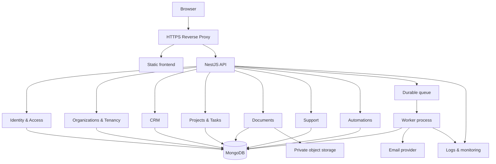
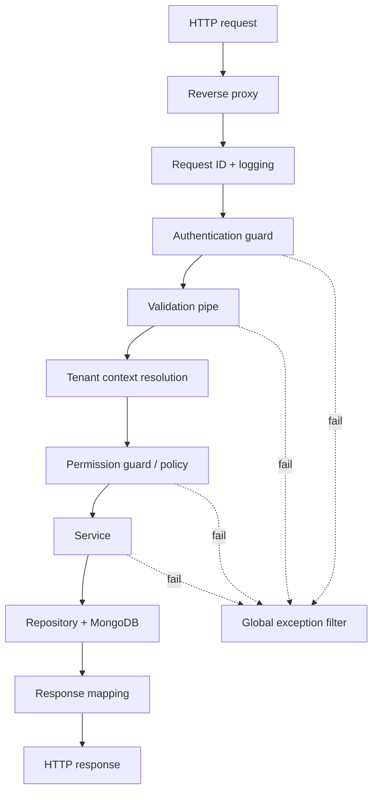
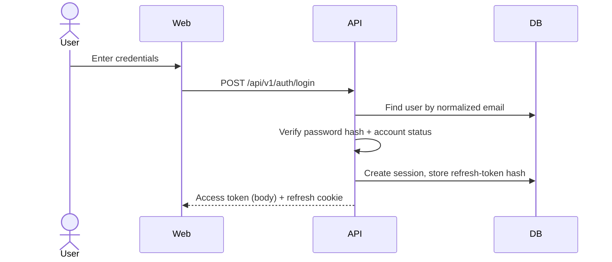

# Nexora OS — Backend Architecture

| Field | Value |
|---|---|
| Document ID | NEX-ARCH-BE-001 |
| Version | 1.1 — foundation implemented (see § 3.2) |
| Status | Draft — review and approve before feature implementation |
| Application | `server/` |
| Stack | NestJS 12 · TypeScript 6 (strict) · MongoDB · Mongoose 9 · Node.js 20.19 (the installed version) |
| Related | [PRD.md](./PRD.md) · [FRONTEND_ARCHITECTURE.md](./FRONTEND_ARCHITECTURE.md) · [TECH_STACK.md](./TECH_STACK.md) |

---

## 1. Purpose and principles

This document defines how the Nexora OS API is structured, how requests flow, how tenants are isolated, how authentication works, and how data, files, jobs, and logs are handled.

**Principles**

1. Security and tenant isolation are mandatory.
2. Modular monolith: one NestJS application, clearly bounded modules.
3. Validate all input at the boundary.
4. Enforce authorization on the server for every protected operation.
5. Design MongoDB indexes from real query patterns.
6. Keep secrets out of code and images.
7. Make critical business rules testable without HTTP.
8. Introduce queues, caches, and abstractions only when a demonstrated need exists.

---

## 2. System overview



The diagram shows logical responsibilities. All API modules run in one NestJS process. The worker shares the codebase and is split into its own process when job workload justifies it.

---

## 3. Folder structure

✅ = exists now · ◻ = planned (created when its milestone starts).

```
server/
├── src/
│   ├── main.ts                       ✅ bootstrap: request ID, helmet, body limit, CORS, prefix, pipes, filter, Swagger
│   ├── app.module.ts                 ✅ ConfigModule (validated) + DatabaseModule + feature modules
│   ├── config/
│   │   └── env.validation.ts         ✅ EnvironmentVariables class + validateEnv() — app refuses to start if invalid
│   ├── common/                       ✅ shared helpers, imported as '@/common'
│   │   ├── index.ts                  ✅ barrel
│   │   ├── dto/
│   │   │   ├── api-response.dto.ts   ✅ ApiResponse<T> success envelope
│   │   │   └── pagination.dto.ts     ✅ PaginationDto (page, limit ≤ 100, sort, order, search) + PaginationMeta
│   │   ├── errors/
│   │   │   ├── error-codes.ts        ✅ ErrorCode (matches client config/errorCodes.ts) + errorCodeForStatus()
│   │   │   ├── app.exception.ts      ✅ AppException(status, message, code?, details?)
│   │   │   └── all-exceptions.filter.ts ✅ global filter → standard error body; hides 500 internals in production
│   │   ├── middleware/
│   │   │   └── request-id.middleware.ts ✅ x-request-id (reuse valid incoming UUID or generate)
│   │   ├── pipes/
│   │   │   └── validation.pipe.ts    ✅ createValidationPipe(): whitelist, forbid extras, transform, field details
│   │   ├── swagger/
│   │   │   └── setup-swagger.ts      ✅ setupSwagger(app) — mounted outside production only
│   │   ├── utils/
│   │   │   ├── id.util.ts            ✅ IdUtil: generateUuid() (crypto.randomUUID), isValidUuid()
│   │   │   ├── string.util.ts        ✅ StringUtil: normalizeEmail, slugify, escapeRegex, toCsvSafe
│   │   │   ├── date.util.ts          ✅ DateUtil: toIsoString, addMinutes, addDays, isExpired
│   │   │   ├── hash.util.ts          ✅ HashUtil: sha256, randomToken, safeEqualHex (Argon2id added in MVP 1)
│   │   │   └── response.util.ts      ✅ createApiResponse(), createPaginationMeta()
│   │   ├── decorators/               ◻ @CurrentUser, @RequirePermission, @Public (MVP 1)
│   │   └── guards/                   ◻ JwtAuthGuard, TenantGuard, PermissionGuard (MVP 1)
│   ├── database/
│   │   ├── database.module.ts        ✅ MongooseModule.forRootAsync (autoIndex off in production)
│   │   ├── base.schema.ts            ✅ BaseDocument (UUID _id, createdBy, updatedBy, timestamps) + TenantDocument (+ organizationId)
│   │   └── migrations/               ◻
│   ├── types/
│   │   └── express.d.ts              ✅ Request.requestId (later: user, tenant context)
│   ├── modules/
│   │   ├── health/                   ✅ GET /health/live, GET /health/ready (checks MongoDB)
│   │   ├── auth/ users/ organizations/ memberships/ invitations/ teams/ permissions/ audit/   ◻ MVP 1
│   │   ├── dashboard/ crm/ projects/ tasks/ documents/ support/                            ◻ MVP Core
│   │   └── notifications/ automations/                                                     ◻ MVP Operations
│   ├── integrations/
│   │   ├── email/                    ◻ MVP 1
│   │   └── storage/                  ◻ MVP Core
│   └── worker/                       ◻ separate entry point when jobs arrive
├── test/                             ◻ e2e API tests
├── .env.example                      ✅ every variable, no real secrets
├── .gitignore  .nvmrc (20)  .prettierrc.json  nest-cli.json  tsconfig.json  README.md   ✅
└── Dockerfile                        ◻ M7
```

Create folders when they get their first file.

**Imports:** outside `common/`, import shared helpers from `'@/common'` (path alias; the Nest CLI rewrites it to relative paths at build). Inside `common/`, use relative imports to avoid cycles.

**TypeScript:** strict mode with `experimentalDecorators` + `emitDecoratorMetadata` (required by Nest DI), `module: nodenext`. The server uses **TypeScript 6.0.3** because TypeScript 7.0 has no programmatic compiler API and the Nest CLI needs one — documented exception in [TECH_STACK.md](./TECH_STACK.md); upgrade when TS 7.1 ships the API.

### 3.1 Inside a module

```
modules/tasks/
├── tasks.module.ts
├── tasks.controller.ts
├── tasks.service.ts
├── tasks.repository.ts
├── dto/
│   ├── create-task.dto.ts
│   ├── update-task.dto.ts
│   └── list-tasks-query.dto.ts
├── schemas/
│   └── task.schema.ts
├── policies/
│   └── task.policy.ts
└── tasks.service.spec.ts
```

| Layer | Responsibility |
|---|---|
| Controller | HTTP routes, decorators, DTO binding, Swagger metadata. No business logic, no raw queries. |
| DTO | Request shape and validation. |
| Service | Business rules and orchestration. |
| Repository | Database queries; always applies tenant scope. |
| Schema | Document shape, constraints, indexes. |
| Policy | Resource-level authorization (ownership, assignment, state). |
| Tests | Business rules and access boundaries. |

Do not create a repository for every trivial operation if it only duplicates Mongoose. Introduce it where it centralizes tenant scoping, reuse, or testability.

A schema for a tenant-owned collection:

```ts
@Schema({ collection: 'tasks', timestamps: true, versionKey: false })
export class Task extends TenantDocument {
  @Prop({ type: String, required: true, trim: true, maxlength: 200 })
  title: string;
}
export const TaskSchema = SchemaFactory.createForClass(Task);
TaskSchema.index({ organizationId: 1, createdAt: -1 });
```

### 3.2 Implemented foundation (verified)

Ported from the svksPrint-iq server setup and hardened for Nexora. Verified against a local MongoDB:

| Check | Result |
|---|---|
| `GET /api/v1/health/live` | `200 { success: true, data: { status: 'ok', uptime } }` |
| `GET /api/v1/health/ready` | `200 { …, database: 'up' }`; `503 SERVICE_UNAVAILABLE` when MongoDB is down |
| Unknown route | `404 { statusCode, code: 'NOT_FOUND', message, requestId }` |
| Invalid `.env` | Startup aborts with a list of invalid variables |
| `x-request-id` | Generated per request; a valid incoming UUID is reused; echoed in errors |
| Security headers | helmet (CSP, nosniff, frame-ancestors, …) |
| CORS | Only `APP_ORIGIN`, with credentials |
| Swagger | `/docs` in development; not mounted in production |

Changed from the previous project on purpose:

| svksPrint-iq | Nexora |
|---|---|
| `strictNullChecks: false`, `noImplicitAny: false` | `strict: true` |
| Config defaults incl. a hard-coded JWT secret | Validated env, no secret defaults |
| CORS `origin: true` + credentials (any site) | Only `APP_ORIGIN` |
| `x-tenant-id` header with default-tenant fallback | Removed; tenant comes from the route + membership check (MVP 1, § 6.2) |
| Error body `{ error: { code: 500, … } }`, raw messages on 500 | `{ statusCode, code, message, details, requestId }`, safe 500 message in production |
| `tenantId` | `organizationId` |
| `uuid` package | Node `crypto.randomUUID()` (no dependency) |
| Swagger always on | Development only |
| Single `/health` | `/health/live` + `/health/ready` |

---

## 4. Module inventory

| Module | Responsibility | Depends on |
|---|---|---|
| Auth | Login, logout, refresh rotation, sessions, verification, password reset | Users, Audit, Email |
| Users | Profiles, account status | — |
| Organizations | Organization lifecycle, slug, settings | Memberships, Audit |
| Memberships | User ↔ organization relationship, role assignment | Permissions |
| Invitations | Create, send, accept, expire invitations | Memberships, Email, Audit |
| Teams | Teams and team membership | Memberships |
| Permissions | Role definitions, permission resolution, policy helpers | — |
| Dashboard | Aggregated organization metrics | CRM, Tasks, Support (read services) |
| CRM | Companies, contacts, leads, opportunities, activities | Audit, Notifications |
| Projects | Projects and project memberships | Memberships |
| Tasks | Tasks, subtasks, comments, status transitions | Projects, Notifications, Audit |
| Documents | File metadata, upload/download, permissions | Storage, Audit |
| Support | Tickets, replies, internal notes, SLA, resolution | Notifications, Audit |
| Notifications | In-app notification records, delivery requests | Email, Queue |
| Automations | Workflow definitions, execution history | Queue, Notifications |
| Audit | Security and business audit events | — |
| Health | Liveness, readiness, dependency checks | Database |

**Dependency rules**

- Modules call each other only through exported public services.
- No circular module dependencies. If two modules need each other, extract the shared piece or use domain events.
- Audit, Notifications, and Permissions are leaf-like shared services; they must not import business modules.

---

## 5. Request lifecycle



**Invariant:** no protected business operation executes before authentication, validation, tenant resolution, and authorization succeed.

NestJS mapping:

| Step | NestJS mechanism |
|---|---|
| Request ID | ✅ `requestIdMiddleware` (first middleware in `main.ts`) |
| Security headers / body limit / CORS | ✅ `helmet()`, `useBodyParser('json', { limit })`, `enableCors({ origin: APP_ORIGIN })` |
| Authentication | ◻ Global `JwtAuthGuard`; `@Public()` opts out (MVP 1) |
| Validation | ✅ `createValidationPipe()` — `whitelist`, `forbidNonWhitelisted`, `transform`, field `details` |
| Tenant context | ◻ `TenantGuard` resolves organization + membership and attaches to request (MVP 1) |
| Authorization | ◻ `PermissionGuard` + `@RequirePermission()`; resource policies inside services (MVP 1) |
| Errors | ✅ `AllExceptionsFilter` producing the standard error format |

---

## 6. Multi-tenancy

A tenant isolation defect exposes one organization's data to another. Tenant boundaries are security controls.

### 6.1 Model

Shared database, shared collections, every tenant-owned document carries `organizationId`.

```
User
 ├── Membership → Organization A (role: admin)
 └── Membership → Organization B (role: member)
```

Identity is global; roles are per membership. Never store one global role on the user.

### 6.2 Tenant context resolution

For every organization-scoped request:

1. Authenticate the user.
2. Read the organization identifier from the validated route parameter.
3. Load the user's membership; require `status = active` and organization not suspended.
4. Resolve effective permissions from the membership's role(s).
5. Attach `{ organizationId, membershipId, permissions }` to the request context.
6. Every repository call receives `organizationId` and applies it to the query.

The slug or ID in the URL is a selector, not proof of authorization.

### 6.3 Data-access rule

```ts
// Unsafe — ignores tenant
taskModel.findById(taskId);

// Required — tenant-scoped
taskModel.findOne({ _id: taskId, organizationId });
```

This applies to reads, lists, updates, deletes, nested resources, file downloads, comments, exports, reports, aggregations (first `$match` stage includes `organizationId`), search, notifications, and background jobs.

A record in another tenant returns `404`, not `403`, so IDs cannot be probed.

Never trust a client-supplied `organizationId` in a body; derive it from the resolved tenant context.

### 6.4 Release-blocking isolation tests

- A member of Org A cannot read, list, update, or delete Org B's records.
- Guessing a record ID does not bypass tenant scope.
- File downloads cannot bypass document authorization.
- Aggregations do not mix organizations.
- Background jobs carry and enforce tenant context.
- Search, notifications, and exports respect tenant boundaries.
- Suspended memberships and suspended organizations are rejected.

---

## 7. Authorization

Role-based access control with explicit permissions plus resource-level policies.

### 7.1 Permission identifiers

```
organization.read          organization.update
members.read               members.invite             members.manage
teams.read                 teams.manage
crm.companies.read         crm.companies.create       crm.companies.update     crm.companies.delete
crm.leads.read             crm.leads.create           crm.leads.update         crm.leads.convert
projects.read              projects.create            projects.update          projects.archive
tasks.read                 tasks.create               tasks.update             tasks.assign
documents.read             documents.upload           documents.delete
support.tickets.read       support.tickets.manage     support.notes.read
automations.read           automations.manage
reports.read               reports.export
audit.read
```

### 7.2 Roles

| Role | Scope |
|---|---|
| Platform Administrator | Platform-level only; separate permission set |
| Organization Owner | All tenant permissions + ownership transfer + org deletion |
| Organization Administrator | Members, teams, settings, all modules |
| Manager | Assign work, approve, reports, team-scoped records |
| Member | Own and assigned records |
| Support Agent | Ticket queues, replies, internal notes |

Code checks permissions (`tasks.assign`), never role names (`role === 'admin'`). The full role → permission matrix is produced in the authorization specification.

### 7.3 Resource policies

Having `tasks.update` does not mean a user can edit every task. Policies also evaluate ownership, project membership, assignment, record state, and confidentiality flags. Policies live in `policies/` and are called from services.

### 7.4 Permission freshness

Permissions are resolved per request from the membership (cache briefly at most, with invalidation on role change), so revocations take effect immediately (IAM-010). Access tokens carry identity only, not tenant permissions.

---

## 8. Authentication and sessions

### 8.1 Model

- Short-lived JWT access token (e.g. 10–15 min), returned in the response body, kept in browser memory.
- Rotating opaque refresh token in an `HttpOnly`, `Secure`, `SameSite` cookie scoped to the refresh path.
- Server stores only a hash of each refresh token in `sessions`, linked to a session family.
- Logout revokes the session server-side and clears the cookie.
- Same-origin deployment preferred (frontend + `/api` behind one host).

Exact lifetimes, cookie attributes, and CSRF controls are finalized in the authentication specification before implementation.

### 8.2 Login



Failed logins return a generic message regardless of whether the email exists (AUTH-012).

### 8.3 Refresh with rotation

1. Client calls `POST /api/v1/auth/refresh`; browser sends the refresh cookie.
2. API looks up the session by token hash.
3. If valid: issue a new refresh token, mark the old one used, return a new access token.
4. If an already-rotated token is presented: treat as theft, revoke the whole session family.
5. A short grace window or client-side single-flight handles legitimate concurrent refreshes.

### 8.4 Password and token security

- Argon2id (or appropriately configured alternative) for password hashing.
- Password changes and resets revoke other sessions.
- Verification, invitation, and reset tokens: random, stored as hashes, single-use, expiring.
- Rate-limit login, refresh, registration, verification, reset, and invitation acceptance.

### 8.5 Cookies and CSRF

- `HttpOnly` + `Secure` + appropriate `SameSite` on the refresh cookie.
- CSRF protection on cookie-authenticated state-changing endpoints (refresh, logout): `SameSite` plus an `Origin` check at minimum.
- CORS restricted to explicit trusted origins only if cross-origin access is ever needed. CORS is not authentication.

---

## 9. API standards

### 9.1 Conventions

- Prefix: `/api/v1`.
- Plural nouns; standard methods.
- Tenant-scoped resources nest under the organization:

```
GET    /api/v1/organizations
POST   /api/v1/organizations
GET    /api/v1/organizations/:orgId
PATCH  /api/v1/organizations/:orgId

GET    /api/v1/organizations/:orgId/tasks
POST   /api/v1/organizations/:orgId/tasks
GET    /api/v1/organizations/:orgId/tasks/:taskId
PATCH  /api/v1/organizations/:orgId/tasks/:taskId
DELETE /api/v1/organizations/:orgId/tasks/:taskId
```

Whether the URL uses ID or slug is decided in the API contract specification; either way, membership is verified per request.

### 9.2 Status codes

| Code | Use |
|---|---|
| 200 | Successful read/update |
| 201 | Created |
| 204 | Successful delete / no body |
| 400 | Validation failed |
| 401 | Not authenticated |
| 403 | Authenticated but not permitted |
| 404 | Not found or not in caller's tenant |
| 409 | Conflict (duplicate, version mismatch) |
| 422 | Valid shape but business rule violated (e.g. illegal status transition) |
| 429 | Rate limited |
| 500 | Unexpected server error |

### 9.3 Error format

```json
{
  "statusCode": 400,
  "code": "VALIDATION_ERROR",
  "message": "The request contains invalid fields.",
  "details": [{ "field": "email", "message": "must be a valid email" }],
  "requestId": "<correlation-id>"
}
```

- Stable, machine-readable `code` values defined in `common/errors/error-codes.ts`: `VALIDATION_ERROR`, `BAD_REQUEST`, `UNAUTHORIZED`, `FORBIDDEN`, `NOT_FOUND`, `CONFLICT`, `GONE`, `PAYLOAD_TOO_LARGE`, `UNPROCESSABLE`, `TOO_MANY_REQUESTS`, `SERVER_ERROR`, `SERVICE_UNAVAILABLE`. They match the client's `config/errorCodes.ts` keys.
- Services throw `AppException(status, message, code?, details?)`; Nest's built-in `HttpException`s are mapped by status.
- No stack traces or database internals in production responses (500 → safe generic message).
- Internal diagnostics are logged with the same `requestId`.

### 9.4 Pagination

All successful responses use `createApiResponse(data, message, meta)`. Lists use `PaginationDto` and `createPaginationMeta(total, page, limit)`:

```json
{
  "success": true,
  "message": "Tasks fetched",
  "data": [],
  "meta": { "total": 0, "page": 1, "limit": 20, "totalPages": 0, "hasNextPage": false, "hasPrevPage": false }
}
```

- Page/limit is the default, with a hard maximum `limit` of 100 (`MAX_PAGE_SIZE`).
- `PaginationDto` provides `page`, `limit`, `sort`, `order` (`asc`/`desc`), `search` and a `skip` getter. Module list DTOs extend it and restrict `sort` with `@IsIn([...allowed fields])`.
- Cursor pagination (`meta: { nextCursor, hasNextPage }`) for high-volume feeds when offset becomes slow.
- Stable sort: always include `_id` as tiebreaker.

### 9.5 Filtering and sorting

- Filter names and sort fields come from an allowlist in the query DTO.
- Reject unknown query parameters and MongoDB operators (`$where`, `$regex` from raw input, etc.).
- Cap date ranges on expensive reports.

### 9.6 DTO validation

- Global `ValidationPipe({ whitelist: true, forbidNonWhitelisted: true, transform: true })`.
- Validate lengths, formats, enums, numeric ranges, UUIDs (`@IsUUID('4')`), nested objects, pagination limits.
- Protected fields (`organizationId`, `createdBy`, `role`) are never accepted from the body (no mass assignment).
- Never pass raw request objects into Mongo filters or updates.

### 9.7 Idempotency and concurrency

- `Idempotency-Key` header for invitation acceptance, workflow triggers, export creation, and any externally retried operation.
- Optimistic concurrency (document `version` field, `409` on mismatch) for records where concurrent edits matter, e.g. tasks (PM-015).

### 9.8 Swagger

Every endpoint documents: auth requirement, required permission, request DTO, response DTO, error codes, pagination, and examples for critical flows. Swagger UI is disabled or protected in production.

### 9.9 Contract lifecycle per feature

1. Define endpoint and permission.
2. Define request and response DTOs.
3. Define success and error behavior.
4. Add Swagger documentation.
5. Implement service and repository.
6. Add unit and integration tests.
7. Integrate frontend.
8. Add E2E coverage for critical journeys.

---

## 10. MongoDB data architecture

### 10.1 Strategy

- One application database; Mongoose schemas with validation and indexes.
- Embed when lifecycle and access are shared and growth is bounded; reference when entities are queried independently or grow without limit.

### 10.2 Collection groups

| Group | Collections |
|---|---|
| Identity & access | `users`, `sessions`, `organizations`, `memberships`, `invitations`, `teams`, `team_memberships`, `roles` |
| Business | `companies`, `contacts`, `leads`, `opportunities`, `activities`, `projects`, `project_memberships`, `tasks`, `comments` |
| Operations | `documents`, `document_versions`, `tickets`, `ticket_replies`, `notifications`, `workflows`, `workflow_executions`, `audit_logs`, `organization_settings`, `integrations`, `outbox_events` |

Final fields are defined in the database design specification.

### 10.3 Common fields

Tenant-owned documents: `_id`, `organizationId`, `createdAt`, `updatedAt`, `createdBy`, `updatedBy`, plus `archivedAt` / `deletedAt` where lifecycle requires it. Global records (`users`) and immutable records (`audit_logs`) follow their own rules.

### 10.4 Candidate indexes

```
users:          unique(emailNormalized)
memberships:    unique(organizationId, userId); (userId, status)
invitations:    unique(tokenHash); (organizationId, status, expiresAt)
companies:      (organizationId, normalizedName); (organizationId, createdAt)
tasks:          (organizationId, projectId, status, createdAt)
                (organizationId, assigneeId, status, dueDate)
notifications:  (userId, readAt, createdAt)
audit_logs:     (organizationId, createdAt); (actorUserId, createdAt)
sessions:       unique(refreshTokenHash); TTL on expiresAt
```

Confirm field order and uniqueness with expected queries and `explain()` before creating.

### 10.5 Query discipline

- No unbounded queries; validated limits everywhere.
- Project only needed fields on large lists.
- No client-controlled sort fields outside the allowlist.
- Avoid unbounded embedded arrays.
- Avoid N+1 lookups; batch with `$in` or `$lookup` where justified.
- Retention policies (TTL indexes or cleanup jobs) for high-volume collections.

### 10.6 Transactions

Use multi-document transactions (replica set required) only where writes must be atomic, e.g. lead conversion. Before using one, define: which writes are atomic, retry behavior, duplicate handling, idempotency key, and which side effects (email, file upload) happen after commit. External side effects are not rolled back by a database transaction; use an outbox if they must be reliable.

### 10.7 Schema evolution

Controlled migration scripts in `database/migrations/` for backfills, format changes, and index creation. Every destructive or large migration needs a backup and a recovery plan. Prefer additive, backward-compatible changes.

---

## 11. File and document storage

### 11.1 Boundary

Bytes in private object storage (local filesystem adapter in development); metadata and permissions in MongoDB:

```
_id, organizationId, uploadedBy, originalFilename, storageKey,
contentType, sizeBytes, checksum, scanStatus, createdAt, deletedAt
```

### 11.2 Upload

1. Authenticate; verify membership and `documents.upload`.
2. Validate declared size and type.
3. Validate actual content (magic bytes), not just extension or client MIME.
4. Generate a random server-controlled `storageKey` (no user input in paths).
5. Upload to private storage.
6. Persist metadata.
7. Clean up on partial failure; track orphans.
8. Write audit event.

### 11.3 Download

1. Authenticate; verify tenant and document permission.
2. Confirm file is active.
3. Stream through the API, or issue a short-lived signed URL.
4. Never log signed URLs; they are bearer credentials.

---

## 12. Background jobs

### 12.1 Strategy

- Run small, fast operations inline at first.
- Introduce a durable queue when work needs retries, delays, scheduling, or must survive restarts. Queue technology is decided in M5.
- The worker runs from `src/worker/` as a separate entry point sharing modules with the API.

### 12.2 Candidate jobs

Verification/invitation/reset emails; notification delivery; CSV exports; scheduled workflow actions; SLA checks; reminders and escalations; file processing; retention cleanup.

### 12.3 Job requirements

Each job defines: unique job ID; `organizationId` when tenant-owned; triggering actor; validated payload; retry policy and backoff; timeout and concurrency limit; idempotency strategy; success/failure state; safe logging; dead-letter or manual recovery path.

A retry must never send duplicate emails or create duplicate records.

### 12.4 Workflow automation

- Fixed catalogue of approved triggers, conditions, and actions. No arbitrary user code (WF-012).
- Limits on steps, duration, retries, actions per organization, concurrency, external requests, and recursion.
- Execution history stored without credentials or sensitive payloads.

---

## 13. Integration boundaries

Provider SDKs live behind small interfaces in `src/integrations/`:

```ts
interface EmailProvider {
  sendVerificationEmail(...): Promise<void>;
  sendInvitationEmail(...): Promise<void>;
  sendPasswordResetEmail(...): Promise<void>;
}

interface FileStorageProvider {
  upload(...): Promise<StoredFile>;
  download(...): Promise<Readable>;
  delete(...): Promise<void>;
  createTemporaryDownloadUrl(...): Promise<string>;
}
```

Conceptual contracts, not final signatures. Every integration has timeouts, safe retries, failure logging, credential rotation, cost visibility, and tests using fakes or sandboxes.

---

## 14. Audit logging

Events: login and security events; membership, invitation, role, and permission changes; organization settings changes; sensitive exports and downloads; document deletion; ticket assignment and resolution; platform administrative actions.

```
_id, organizationId, actorUserId, action, resourceType, resourceId,
outcome (success | denied | failed), timestamp, requestId, metadata
```

- Append-only through the application; no update/delete endpoints.
- Never log passwords, tokens, secrets, or document contents.
- Access restricted to `audit.read`.
- Explicit retention policy.

---

## 15. Observability

### 15.1 Structured logs

JSON logs with: timestamp, level, service, environment, `requestId`, route, status, duration, safe error code, `organizationId` where safe. No full request bodies by default. Redact authorization headers and cookies.

### 15.2 Health endpoints

| Endpoint | Meaning |
|---|---|
| `GET /api/v1/health/live` | Process is alive |
| `GET /api/v1/health/ready` | Instance can serve traffic (DB reachable) |

Health responses expose no secrets or infrastructure details.

### 15.3 Monitoring

Track: application errors, API latency, 4xx/5xx rates, DB connection failures, memory and disk, queue backlog and failed jobs, storage failures, email failures, backup status.

---

## 16. Security checklist (backend)

- Validate all untrusted input; whitelist DTOs.
- Server-side authorization on every protected operation.
- Tenant-scoped data access everywhere.
- Argon2id password hashing.
- Refresh rotation, reuse detection, revocation.
- Rate limits on sensitive endpoints.
- Narrow CORS; CSRF protection for cookie endpoints.
- NoSQL injection prevention (no raw objects into queries; strip `$` keys).
- Request body and upload size limits.
- No mass assignment of protected fields.
- Safe redirects (internal-path allowlist).
- CSV formula injection escaping on export.
- Security headers (e.g. Helmet).
- No stack traces in production errors.
- Secrets from environment only; validated at startup; never logged.
- Dependency vulnerability scanning in CI.

Security defects affecting authentication, tenant isolation, or sensitive data are release blockers.

---

## 17. Configuration

- ✅ `@nestjs/config` with `validate: validateEnv` (`config/env.validation.ts`, class-validator). The app refuses to start on missing or invalid config.
- Read values through `ConfigService<EnvironmentVariables, true>` with `config.get('PORT', { infer: true })` — typed, never `process.env` in feature code.
- `.env` (ignored) in development; protected server-side secrets in production.
- `.env.example` documents every variable with placeholders. Add a variable to the class, `.env.example` and this table together.

| Variable | Default | Rule | Since |
|---|---|---|---|
| `NODE_ENV` | `development` | `development` \| `test` \| `production` | ✅ |
| `PORT` | `3000` | 1–65535 | ✅ |
| `API_PREFIX` | `api/v1` | string | ✅ |
| `APP_ORIGIN` | — (required) | http(s) URL; the only CORS origin | ✅ |
| `MONGODB_URI` | — (required) | `mongodb://` or `mongodb+srv://` | ✅ |
| `BODY_LIMIT` | `1mb` | e.g. `100kb`, `1mb` | ✅ |
| `JWT_ACCESS_SECRET` | — (required) | ≥ 32 chars, no default | ◻ MVP 1 |
| `JWT_ACCESS_TTL` / `REFRESH_TOKEN_TTL` | `15m` / `30d` | duration | ◻ MVP 1 |
| `COOKIE_SECURE` | `true` in production | boolean | ◻ MVP 1 |

---

## 18. Testing

| Level | Tools | Focus |
|---|---|---|
| Unit | Jest | Services, policies, status transitions, permission resolution |
| Integration | Jest + Supertest + test MongoDB | Controllers, validation, persistence, error format |
| Security | Jest + Supertest | Cross-tenant access, role escalation, session revocation, refresh reuse, injection, rate limits |
| Concurrency | Jest | Optimistic locking, idempotency keys |
| Queue | Jest | Retries, deduplication |
| Smoke | HTTP checks | Post-deploy health and key endpoints |

- Use an isolated test database (in-memory MongoDB or a disposable container).
- Deterministic fixtures and factories; no dependence on test order.
- Never point automated tests at production.

---

## 19. Performance

- Target p95 ≤ 500 ms for common interactive endpoints under a defined baseline workload (NFR-001); measured, not assumed.
- Paginate all collection endpoints; index frequent filters and sorts.
- Move long-running work to jobs; stream large files.
- Timeouts on external calls; monitor connection pool.
- Add caching only after a measured bottleneck.

**Scaling path:** optimize queries/indexes → tune config → add resources → split worker → cache measured hot paths → horizontal API scaling → consider service extraction only with evidence.

---

## 20. Open backend decisions

| Decision | Needed by |
|---|---|
| URL tenant identifier (ID vs slug) | API contract spec |
| Final token lifetimes, cookie attributes, CSRF approach | M2 |
| Password hashing parameters | M2 |
| Logger library (Nest `Logger` for now; structured JSON logger later) | M1 |
| Migration tooling | M1 |
| Test runner for the server (Jest needs a TS 6-compatible ts-jest; re-check at setup) | M1 |
| Upgrade server to TypeScript 7.1 when the compiler API returns | When TS 7.1 is released |
| Email provider | M2 |
| Storage provider | M3 |
| Queue technology and Redis hosting | M5 |
| Outbox pattern adoption | M5 |
| Audit log retention period | M4 |
