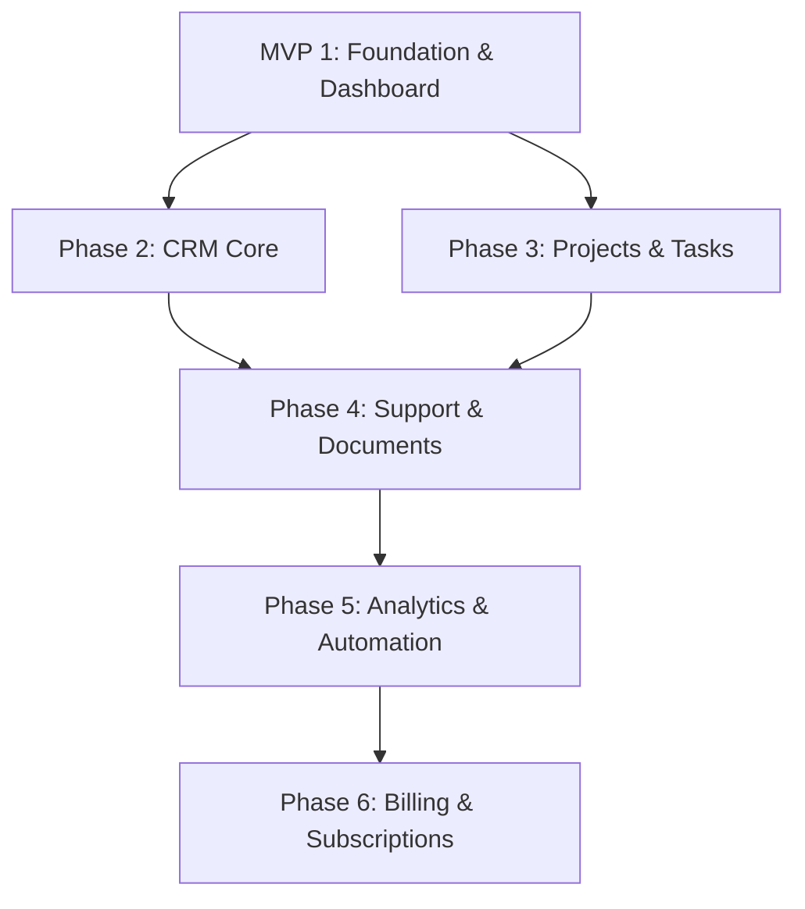

# Nexora OS — MVP 1 Manual Testing Guide, User Manual & Advanced Feature Roadmap

**Version:** 1.0  
**Phase:** MVP 1 Foundation & Dashboard Baseline  
**Date:** October 2026  
**Reference Standards:** [`docs/PRD.md`](./PRD.md) · [`docs/MVP1_FOUNDATION.md`](./MVP1_FOUNDATION.md) · [`docs/MVP1_SPECIFICATION.md`](./MVP1_SPECIFICATION.md) · [`docs/CODING_STANDARDS.md`](./CODING_STANDARDS.md)

---

## 1. Executive Summary & Verification Baseline

Nexora OS MVP 1 establishes a multi-tenant business operations platform. All Foundation modules and the Workspace Operations Dashboard are fully implemented, end-to-end type-safe, and verified by automated unit and smoke tests.

### Current Implementation Status
- **Backend Architecture:** NestJS 12, MongoDB with Mongoose, UUID v4 primary identifiers, tenant-scoped queries (`organizationId`), Argon2id password hashing, and SHA-256 session family tracking.
- **Frontend Architecture:** React 19, Vite, TypeScript, Tailwind CSS v4, `@/components/ui` primitives, strictly `rounded-md`, zero drop shadows, custom modern charts with Recharts.
- **Module Coverage:** 
  - ✅ Authentication & Session Lifecycle (Registration, Verification, Login, Silent Refresh, Password Reset, Logout)
  - ✅ User Profile & Account Settings (`/account`)
  - ✅ Organization & Workspace Management (`/workspaces`, `/workspaces/new`)
  - ✅ General Workspace Settings (`/workspace/:slug/settings/general`)
  - ✅ Team Members & Invitations (`/workspace/:slug/settings/members`)
  - ✅ Teams & Functional Departments (`/workspace/:slug/settings/teams`)
  - ✅ Roles & Permissions Security Matrix (`/workspace/:slug/settings/roles`)
  - ✅ Security Audit & Activity Trail (`/workspace/:slug/activity`)
  - ✅ Workspace Operations Dashboard (`/workspace/:slug/dashboard`)

This document serves as both a **step-by-step User Manual** for operators and a **Manual QA Test Plan** with edge cases, acceptance criteria, and future feature plans.

---

## 2. Testing Environment & Persona Matrix

### 2.1 Local Environment Coordinates
- **Web Client:** `http://localhost:5174` (or `http://localhost:5173`)
- **Backend API:** `http://localhost:3000/api/v1`
- **Swagger Documentation:** `http://localhost:3000/api/docs`
- **Database:** Local or Cloud MongoDB (`nexora` database)

### 2.2 Test User Personas
| Persona | Email | Default Role | Primary Capabilities |
|---|---|---|---|
| **Alex Rivera** | `alex@acme.corp` | `Owner` | Full organization control, slug change, ownership transfer, soft delete |
| **Bianca Chen** | `bianca@acme.corp` | `Admin` | Member invites, role assignments, team roster configuration, audit log review |
| **Carlos Gomez** | `carlos@acme.corp` | `Manager` | Team lead, member assignment, operational review, dashboard insights |
| **David Kim** | `david@acme.corp` | `Member` | Standard workspace collaboration, view roster, own tasks |
| **Elena Rostova** | `elena@acme.corp` | `Support Agent` | Customer support, ticket management, internal notes |

---

## 3. Module User Guides & Manual Test Cases

---

### Module 1: Authentication & Session Lifecycle
**Routes:** `/register` · `/login` · `/verify-email` · `/forgot-password` · `/reset-password`

#### User Guide & Operational Flow
1. **Registration:** Navigate to `/register`. Provide Full Name, Work Email, and a strong password (8+ characters, uppercase, lowercase, number, symbol). Click **Create account**.
2. **Email Verification:** A single-use verification link is dispatched to your email. Click the link or navigate to `/verify-email?token=<token>`. Once verified, login is activated.
3. **Login:** Navigate to `/login`. Enter your email and password. Upon successful authentication, your short-lived access token is stored in memory, a secure rotating refresh cookie is stored, and you are redirected to `/workspaces`.
4. **Password Recovery:** From `/login`, click **Forgot password?**. Enter your email. Open the reset link (`/reset-password?token=<token>`), provide a new password, and submit. All existing active sessions across all devices are immediately terminated.

#### Manual Test Cases Matrix
| Test ID | Scenario | Steps to Execute | Expected Result | Pass/Fail |
|---|---|---|---|---|
| **TC-AUTH-001** | Happy Path Registration | 1. Go to `/register` 2. Enter name, unused email, valid strong password 3. Submit form | Success toast appears; prompt to verify email is displayed; user record created with `status: "pending"`. | [ ] |
| **TC-AUTH-002** | Password Strength Validation | 1. Go to `/register` 2. Try weak passwords (e.g. `123456`, `password`, `Nocpas1`) 3. Inspect UI feedback | Form shows validation warnings for missing requirements; submit button is disabled or triggers validation error. | [ ] |
| **TC-AUTH-003** | Generic Error on Invalid Login | 1. Go to `/login` 2. Enter nonexistent email or incorrect password 3. Submit | Banner reads `"Invalid email or password"`. No hint whether email exists or not. | [ ] |
| **TC-AUTH-004** | Silent Token Refresh on Reload | 1. Sign in successfully 2. Refresh browser window (F5) 3. Check DevTools Network tab | App issues `POST /auth/refresh` with HttpOnly cookie; acquires new access token without forcing user to re-login. | [ ] |
| **TC-AUTH-005** | Refresh Token Reuse Detection | 1. Capture refresh token cookie 2. Trigger refresh twice with the same stale cookie | Server detects token reuse, flags family compromised, and clears all user sessions. Next request redirects to `/login`. | [ ] |
| **TC-AUTH-006** | Logout Session Invalidation | 1. Click user avatar menu -> **Sign Out** 2. Inspect cookies and storage | Refresh cookie is cleared; memory token wiped; app navigates to `/login`. Back button cannot access protected routes. | [ ] |

---

### Module 2: User Account & Profile Settings
**Routes:** `/account`

#### User Guide & Operational Flow
1. Click your profile avatar in the upper right header or sidebar footer and select **Account Settings**.
2. **Profile & Preferences:** Update your name, preferred timezone, and locale. Click **Save Changes**.
3. **Security & Sessions:** View all active devices and browser sessions with IP address, browser type, and last active time. Click **Revoke** on any stale session to terminate it immediately.

#### Manual Test Cases Matrix
| Test ID | Scenario | Steps to Execute | Expected Result | Pass/Fail |
|---|---|---|---|---|
| **TC-ACC-001** | Update Profile Information | 1. Go to `/account` 2. Edit display name and select a new timezone 3. Click Save Changes | Toast confirms update; header avatar displays updated name/initials immediately. | [ ] |
| **TC-ACC-002** | Active Sessions Inspection | 1. Open app in two different browsers (Chrome & Edge) 2. Visit `/account` in Chrome | Both active sessions are listed with correct browser badges; current session has "Current" badge. | [ ] |
| **TC-ACC-003** | Remote Session Termination | 1. From Chrome, click "Revoke" on Edge session 2. Switch to Edge and click any link | Edge receives 401 Unauthorized, memory token cleared, and redirects to `/login`. | [ ] |

---

### Module 3: Workspaces & Tenant Discovery
**Routes:** `/workspaces` · `/workspaces/new`

#### User Guide & Operational Flow
1. Upon logging in without a specific workspace slug, or by clicking the organization switcher dropdown, select **Manage Workspaces** (`/workspaces`).
2. All workspaces you belong to are displayed with your assigned role (`Owner`, `Admin`, `Member`, etc.) and quick launch buttons.
3. To start a new company workspace, click **Create Workspace** (`/workspaces/new`). Provide Workspace Name and custom Slug. You will automatically be assigned as `Owner`.

#### Manual Test Cases Matrix
| Test ID | Scenario | Steps to Execute | Expected Result | Pass/Fail |
|---|---|---|---|---|
| **TC-WS-001** | Workspace Switching | 1. Ensure user belongs to Org A and Org B 2. Switch from Org A to Org B in switcher | URL updates to `/workspace/org-b/dashboard`; sidebar and header show Org B context; all data is strictly scoped to Org B. | [ ] |
| **TC-WS-002** | Create New Workspace | 1. Go to `/workspaces/new` 2. Enter "Solaris Labs", slug `solaris-labs` 3. Click Create Workspace | Workspace created; creator is assigned `owner` role; redirected to `/workspace/solaris-labs/dashboard`. | [ ] |
| **TC-WS-003** | Slug Normalization & Collision | 1. Try creating a workspace with duplicate slug or uppercase/spaces (`Solaris Labs!`) | Form normalizes to `solaris-labs` and alerts if the slug is already taken globally. | [ ] |
| **TC-WS-004** | Cross-Tenant Isolation | 1. Login as Member of Org A 2. Manually enter `/workspace/secret-org-b/settings/general` in URL | Access is blocked with 403 Forbidden or 404 Not Found; no data leak from unauthorized tenant. | [ ] |

---

### Module 4: Organization General Settings
**Routes:** `/workspace/:slug/settings/general`

#### User Guide & Operational Flow
1. Navigate to **Settings** -> **General** in the sidebar.
2. **Workspace Profile:** Update workspace business name, primary timezone, and currency.
3. **Change Workspace Slug:** Owners and Admins can update the workspace URL slug. The system validates real-time availability and automatically updates browser URL routing upon save.
4. **Transfer Ownership:** Current Owner can select another active Admin or Member from a dropdown and transfer organization ownership.
5. **Danger Zone:** Soft-deletes the workspace with a documented retention period.

#### Manual Test Cases Matrix
| Test ID | Scenario | Steps to Execute | Expected Result | Pass/Fail |
|---|---|---|---|---|
| **TC-SET-001** | Update Workspace Profile | 1. Change Workspace Name to "Acme Global" 2. Change Timezone to "America/New_York" 3. Save Changes | Header and sidebar update to "Acme Global" immediately; audit event recorded in activity log. | [ ] |
| **TC-SET-002** | Live Slug Renaming | 1. Enter a new slug `acme-global` 2. Click Update Slug | System updates slug; URL seamlessly switches to `/workspace/acme-global/settings/general` without broken state. | [ ] |
| **TC-SET-003** | Ownership Transfer | 1. As Owner, select Bianca Chen in Transfer Ownership modal 2. Confirm modal dialog | Bianca becomes `Owner`; previous user becomes `Admin`; UI updates permissions instantly. | [ ] |
| **TC-SET-004** | Non-Owner Permission Block | 1. Sign in as `Member` 2. Navigate to `/workspace/:slug/settings/general` | Danger Zone and Ownership transfer controls are hidden; direct API calls return 403 Forbidden. | [ ] |

---

### Module 5: Team Members & Collaborative Invitations
**Routes:** `/workspace/:slug/settings/members`

#### User Guide & Operational Flow
1. Navigate to **Settings** -> **Team Members**.
2. **Active Members Tab:** View all active workspace users, their assigned roles, join dates, and actions.
3. **Invite Member:** Click **Invite Member**. Enter collaborator email and select their role (`Admin`, `Manager`, `Member`, `Support Agent`).
4. **Pending Invitations Tab:** Track pending invitations. Actions include **Resend Invite** and **Revoke**.
5. **Accepting Invitations:** Invitee receives email with link `/accept-invitation?token=<token>`. If new, they set a password; if existing user, they confirm and join the workspace.

#### Manual Test Cases Matrix
| Test ID | Scenario | Steps to Execute | Expected Result | Pass/Fail |
|---|---|---|---|---|
| **TC-MEM-001** | Send Invitation | 1. Click Invite Member 2. Enter `newuser@acme.corp`, role `Manager` 3. Click Send Invitation | Invitation appears in "Pending Invitations" list; audit event logged; invite token generated. | [ ] |
| **TC-MEM-002** | Revoke Invitation | 1. In Pending Invitations, click "Revoke" on an invite 2. Confirm dialog | Invitation is cancelled; token is marked invalid; cannot be accepted by recipient. | [ ] |
| **TC-MEM-003** | Change Member Role | 1. In Active Members tab, open Role dropdown for Carlos Gomez 2. Select "Admin" | Role updates in database immediately; Carlos gains administrative privileges on next interaction. | [ ] |
| **TC-MEM-004** | Last Owner Protection | 1. Locate the sole Owner in the members list 2. Attempt to delete or demote the owner | Action is disabled or blocked with error: `"Cannot remove or demote the last organization owner"`. | [ ] |
| **TC-MEM-005** | Privilege Escalation Block | 1. Log in as `Manager` 2. Attempt to invite a user with `Admin` or `Owner` role | Role selector only permits roles equal or lower than caller's role; backend rejects privilege escalation. | [ ] |

---

### Module 6: Teams & Department Rosters
**Routes:** `/workspace/:slug/settings/teams`

#### User Guide & Operational Flow
1. Navigate to **Settings** -> **Teams & Departments**.
2. **Team Cards Grid:** View all functional units (e.g. Engineering, Sales, Customer Support) with designated Team Lead and member headcount.
3. **Create Team:** Click **Create Team**. Enter team title, operational description, and select a Team Lead from the member directory.
4. **Manage Roster:** Click **Manage Members** on any team card. Select or deselect members using the multi-select picker and click **Save Roster**.
5. **Edit / Delete Team:** Use card action buttons to edit team details or delete a team.

#### Manual Test Cases Matrix
| Test ID | Scenario | Steps to Execute | Expected Result | Pass/Fail |
|---|---|---|---|---|
| **TC-TEAM-001** | Create Functional Team | 1. Click Create Team 2. Name: "Solutions Architecture", Lead: "Carlos Gomez" 3. Submit | Team card appears with lead avatar and member count 1; audit log entry recorded. | [ ] |
| **TC-TEAM-002** | Manage Team Roster | 1. Click "Manage Members" on Solutions Architecture 2. Add Bianca and David 3. Save | Roster updates to 3 members; badge on card increments; modal closes with success toast. | [ ] |
| **TC-TEAM-003** | Delete Team Confirmation | 1. Click Delete on a team card 2. Review confirmation prompt 3. Confirm deletion | Team is removed from workspace; associated member records unlinked safely; toast confirms deletion. | [ ] |

---

### Module 7: Roles & Granular Permissions Matrix
**Routes:** `/workspace/:slug/settings/roles`

#### User Guide & Operational Flow
1. Navigate to **Settings** -> **Roles & Permissions**.
2. **Security Model Matrix:** View a structured matrix of 23 granular capabilities across 6 operational categories:
   - Organization Administration (`org.update`, `org.delete`, `org.transfer`)
   - Members & Access (`members.invite`, `members.update`, `members.remove`)
   - Teams & Departments (`teams.create`, `teams.update`, `teams.delete`)
   - Security & Audit (`audit.view`, `sessions.manage`)
   - CRM & Pipeline (`crm.companies.manage`, `crm.contacts.manage`, `crm.deals.manage`)
   - Projects & Tasks (`projects.manage`, `tasks.manage`)
3. Review exact capability checkboxes assigned to each system role (`Owner`, `Admin`, `Manager`, `Member`, `Support Agent`).

#### Manual Test Cases Matrix
| Test ID | Scenario | Steps to Execute | Expected Result | Pass/Fail |
|---|---|---|---|---|
| **TC-ROLE-001** | Inspect Permissions Matrix | 1. Navigate to `/workspace/:slug/settings/roles` 2. Filter by category or search "invite" | Capability matrix displays green checked badges for authorized roles and blank/gray for unauthorized. | [ ] |
| **TC-ROLE-002** | Enforcement of `<Can>` Guard | 1. Log in as `Member` (lacks `teams.create`) 2. Visit `/workspace/:slug/settings/teams` | "Create Team" button is hidden from UI; direct API call returns 403 Forbidden. | [ ] |
| **TC-ROLE-003** | Dynamic Role Demotion | 1. While user is logged in as Admin in one tab, demote to Member in another 2. In first tab, try to perform an Admin action | Next request evaluates refreshed token/session and denies access with 403 Forbidden. | [ ] |

---

### Module 8: Security Audit & Activity Trail
**Routes:** `/workspace/:slug/activity`

#### User Guide & Operational Flow
1. Navigate to **Activity** in the sidebar.
2. **Activity Timeline:** Real-time chronological trail of all security and administrative events.
3. **Filtering:** Filter events by Actor name, Action type (`member.invited`, `team.created`, `org.updated`), Target entity, and Date range.
4. **Deep Inspection Modal:** Click **Inspect** on any event row to open a slide-over modal displaying actor IP address, User-Agent, Request ID, and formatted JSON payload diff.

#### Manual Test Cases Matrix
| Test ID | Scenario | Steps to Execute | Expected Result | Pass/Fail |
|---|---|---|---|---|
| **TC-AUD-001** | Automated Event Logging | 1. Create a new team or update workspace name 2. Navigate to `/workspace/:slug/activity` | Event appears at top of feed with correct actor, target entity, timestamp, and badge. | [ ] |
| **TC-AUD-002** | Filter Audit Records | 1. Filter by Action: `team.created` 2. Press Filter | Feed only shows team creation entries; pagination total adjusts accurately. | [ ] |
| **TC-AUD-003** | Deep Inspection Modal | 1. Click "Inspect" on any audit record | Modal opens displaying Request ID, IP Address, User-Agent, and colorized JSON payload. | [ ] |
| **TC-AUD-004** | Sensitive Data Masking | 1. Inspect a password change or login event in audit log | Passwords, tokens, and secret hashes are strictly excluded/redacted from payload. | [ ] |

---

### Module 9: Workspace Operations Dashboard
**Routes:** `/workspace/:slug/dashboard`

#### User Guide & Operational Flow
1. Navigate to **Dashboard** (`/workspace/:slug/dashboard`).
2. **KPI Metric Tiles:** High-level summary counters for Active Members, Functional Teams, Pending Invitations, and Total Audit Events.
3. **Onboarding Checklist:** 0–100% setup guide highlighting key milestones (Invite team members, configure functional departments, review security matrix). Includes quick links to jump directly to setup pages.
4. **Activity Velocity Chart:** Interactive dual-gradient area spline tracking 7-day operational throughput (user actions vs. security events). Offers interactive `7D`, `30D`, and `90D` intervals.
5. **Team Distribution Donut:** Jewel-tone semi-donut displaying team headcount proportions with a center KPI badge and interactive side breakdown percentages.
6. **Recent Activity Feed:** Live list of the 5 most recent workspace events with quick links to view the full audit trail.

#### Manual Test Cases Matrix
| Test ID | Scenario | Steps to Execute | Expected Result | Pass/Fail |
|---|---|---|---|---|
| **TC-DASH-001** | Metric Counters Accuracy | 1. Note count of Active Members and Teams on dashboard 2. Add a new team and invite a member 3. Return to dashboard | Counters increment immediately to reflect live counts. | [ ] |
| **TC-DASH-002** | Onboarding Progress Calculation | 1. In a fresh workspace (no teams, 1 member), view checklist 2. Add a team and invite a second member 3. Return to dashboard | Progress bar advances from 33% to 100%; completed tasks display green checkmarks. | [ ] |
| **TC-DASH-003** | Activity Velocity Range Switch | 1. Click "30D" or "90D" interval buttons on Velocity Chart | Chart smoothly transitions dataset; tooltips reflect selected range without UI stutter. | [ ] |
| **TC-DASH-004** | Team Donut Hover & Breakdown | 1. Hover over segments on the Team Distribution Donut | Tooltip shows exact member count and percentage; center KPI displays total active members. | [ ] |
| **TC-DASH-005** | Quick Action Buttons | 1. Click "Invite Member" or "New Team" in the dashboard header | Directly opens the corresponding modal or navigates to the configuration page. | [ ] |

---

## 4. End-to-End User Journeys (Integration Scenarios)

### Scenario A: New Organization Onboarding Lifecycle
1. **User Registers:** Alex registers at `/register` -> verifies email -> logs in.
2. **Workspace Creation:** Creates workspace "Apex Innovations" (`apex-innovations`).
3. **Team Structure:** Alex visits `/workspace/apex-innovations/settings/teams` and creates "Product Design" and "Engineering".
4. **Member Invitations:** Alex invites Bianca (`Admin`) and Carlos (`Manager`).
5. **Roster Assignment:** Alex assigns Carlos as Lead of Engineering and adds Bianca to Product Design.
6. **Dashboard Verification:** Alex navigates to `/workspace/apex-innovations/dashboard` and confirms 100% onboarding completion, 3 KPI cards populated, and donut chart reflecting team distribution.

### Scenario B: Security Invalidation & Session Cleanup
1. User logs into Chrome and Firefox simultaneously.
2. User triggers a Password Reset from `/forgot-password`.
3. User completes reset via email token.
4. **Verification:** Both Chrome and Firefox sessions are invalidated. Any subsequent click redirects immediately to `/login?reason=session_expired`.

---

## 5. Advanced Feature Roadmap (Post-MVP 1 / Core Tier)

With MVP 1 Foundation and Dashboard complete, the following advanced modules are scheduled for the next development sprints.

---

### 5.1 CRM & Sales Intelligence Engine (`/crm/*`)
*Priority: P0 · Target Routes: `/crm/companies`, `/crm/contacts`, `/crm/leads`, `/crm/opportunities`, `/crm/activities`*

#### 1. Companies & Accounts Management (`/crm/companies`)
- **Backend Model:**
  - `Company` schema: UUID v4 `id`, tenant-scoped `organizationId`, `name`, `domain`, `industry`, `employeeCountTier`, `website`, `phone`, `address`, `tags`, `status` (`lead`, `prospect`, `customer`, `partner`, `churned`).
  - Strict unique index on `{ organizationId, domain }` to prevent duplicate account creation within a tenant.
- **Frontend Architecture:**
  - `CompaniesPage.tsx`: Data table with search, industry filter pills, status badges, and column sorting.
  - `CreateCompanyModal.tsx` & `CompanyDrawer.tsx`: Fast account registration dialog and 360-degree company inspection drawer.
  - Associated contacts list and revenue stats embedded in company view.

#### 2. Contacts Directory (`/crm/contacts`)
- **Backend Model:**
  - `Contact` schema: UUID v4 `id`, `organizationId`, `companyId`, `firstName`, `lastName`, `email`, `phone`, `jobTitle`, `department`, `isPrimaryContact`, `socialProfiles`.
- **Frontend Architecture:**
  - `ContactsPage.tsx`: Interactive contact directory with avatar initials, company badge links, direct `mailto:` / phone actions, and search-as-you-type.

#### 3. Lead Conversion & Opportunity Pipeline (`/crm/opportunities`, `/crm/leads`)
- **Pipeline Kanban Board:**
  - Visual stages: `Lead Qualification` -> `Discovery` -> `Proposal/Quote` -> `Negotiation` -> `Closed Won` / `Closed Lost`.
  - Drag-and-drop card interaction with total pipeline deal value calculation per column.
  - Automated conversion: Convert qualified Lead into Company + Contact + Opportunity in a single atomic transaction.

#### 4. Activity & Interaction Logs (`/crm/activities`)
- Log meetings, call notes, emails, and follow-up reminders associated with any company or deal.

---

### 5.2 Project Execution & Task Management (`/projects`, `/tasks`)
*Priority: P0 · Target Routes: `/projects`, `/tasks`*

#### 1. Project Workspaces (`/projects`)
- Multi-tenant project entity with project code/prefix (e.g. `PRJ-`), project manager assignment, health status (`On Track`, `At Risk`, `Delayed`), target budget, and milestone dates.
- Project members and role overrides per project.

#### 2. List & Kanban Task Engine (`/tasks`)
- Tasks with subtasks, checklists, priorities (`Low`, `Medium`, `High`, `Urgent`), labels/tags, due dates, and rich markdown descriptions.
- **Dual Views:** Switch seamlessly between Tabular List view and Kanban Board view.
- Real-time comment stream with `@mention` notifications and file attachments.

---

### 5.3 Document Management & Media Drive (`/documents`)
*Priority: P1 · Target Route: `/documents`*

- **Virtual Folder Hierarchy:** Nested folders with inheritance-based permission controls.
- **Secure File Storage:** Multi-part file upload with S3-compatible cloud storage adapter, virus scanning, and mime-type whitelist validation.
- **Direct Previews:** In-browser preview for PDF, standard images (PNG, JPEG, SVG), and plain-text code snippets.
- **Signed Download URLs:** Time-limited signed URLs ensuring assets cannot be shared with unauthorized third parties.

---

### 5.4 Helpdesk & Support Ticketing (`/support/tickets`)
*Priority: P1 · Target Route: `/support/tickets`*

- **Ticket Lifecycle:** `New` -> `Assigned` -> `In Progress` -> `Pending Customer` -> `Resolved` -> `Closed`.
- **SLA & Priority Escalations:** Automated timers tracking first-response time and resolution deadlines.
- **Internal Collaboration:** Support agents can post private internal notes hidden from external customers.
- **Customer Email Portal:** Convert inbound customer support emails into threaded tickets.

---

### 5.5 In-App Notifications & Alerts (`/notifications`)
*Priority: P1 · Target Route: `/notifications`*

- **Header Notification Center:** Notification bell icon with real-time unread badge counter.
- **Actionable Notifications:** Click-through deep links directly navigating to the relevant task, invite, or audit event.
- **User Notification Preferences:** Granular toggle controls per channel (In-app, Email digest, Instant alert).

---

### 5.6 Advanced Reporting & Analytics (`/reports`)
*Priority: P1 · Target Route: `/reports`*

- **Operational Insights:** Cross-module performance summaries (Sales velocity, project sprint burndown, support ticket resolution time).
- **Export Capabilities:** One-click asynchronous export of reports to CSV and formatted PDF.
- **Scheduled Digests:** Weekly executive summary email delivered to Organization Owners and Managers.

---

### 5.7 Multi-Tenant Billing & Subscription Metering (`/settings/billing`)
*Priority: P2 · Target Route: `/workspace/:slug/settings/billing`*

- **Stripe Billing Integration:** Customer portal for managing payment methods, invoices, and receipts.
- **Tier Limits & Seat Metering:** Enforce plan restrictions (e.g. Free Tier: up to 5 members; Pro Tier: unlimited members, advanced audit history, custom branding).
- **Grace Period & Downgrade Policies:** Documented downgrade safety preserving tenant data during payment lapse.

---

## 6. Manual Testing Sign-Off Checklist

Before promoting any build to staging or production, execute this rapid QA verification gate:

- [ ] **Auth Gate:** Register new user -> Verify email -> Login -> Reload page (silent refresh succeeds).
- [ ] **Isolation Gate:** Log in with Org A user -> attempt to fetch Org B records via API -> Verify 403/404 response.
- [ ] **Role Gate:** Log in as Member -> Verify Settings Danger Zone and Role assignment controls are completely inaccessible.
- [ ] **Audit Gate:** Perform 3 administrative actions -> Navigate to `/activity` -> Confirm records match timestamp, actor, and IP.
- [ ] **Dashboard Gate:** Navigate to `/dashboard` -> Verify Velocity Spline and Team Donut charts render without console errors.
- [ ] **Regression Gate:** Run `npm run test -- --run` in `client/` and `npm run build` in `server/` -> All tests pass with zero warnings.
